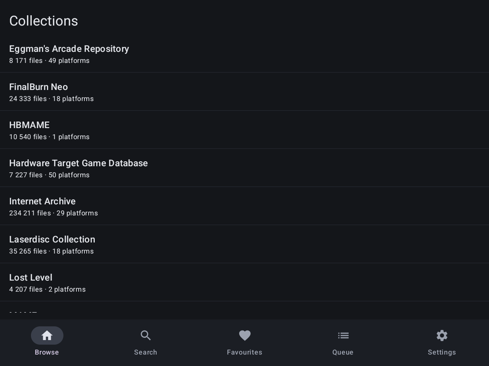
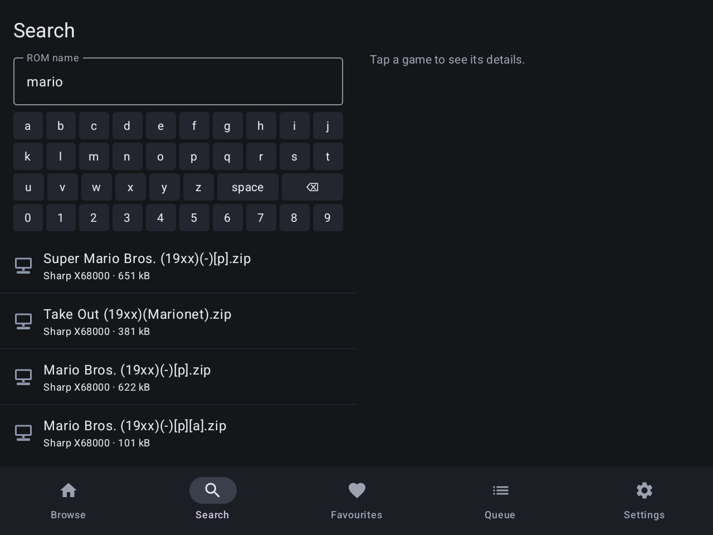
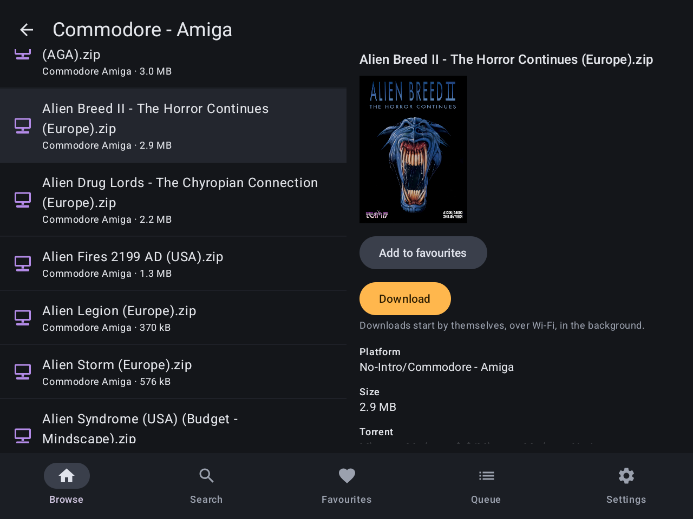
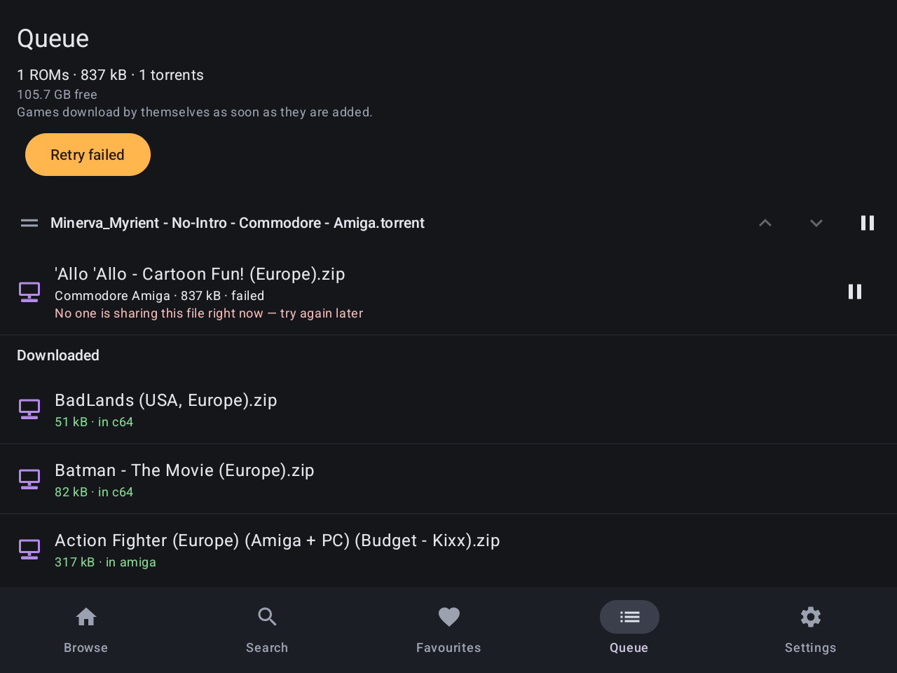
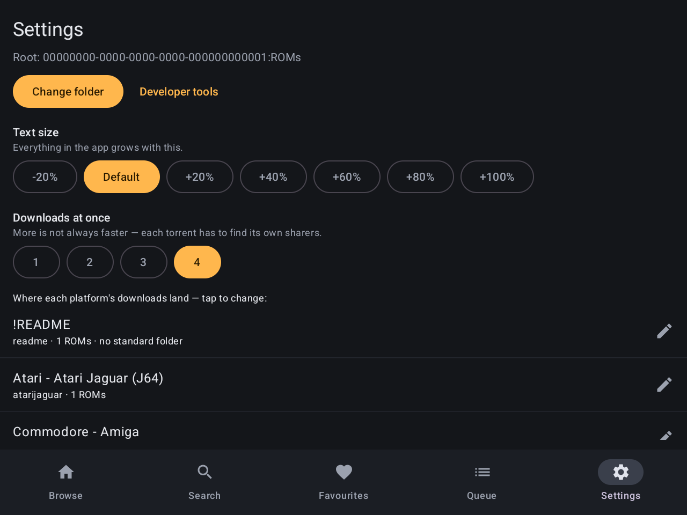
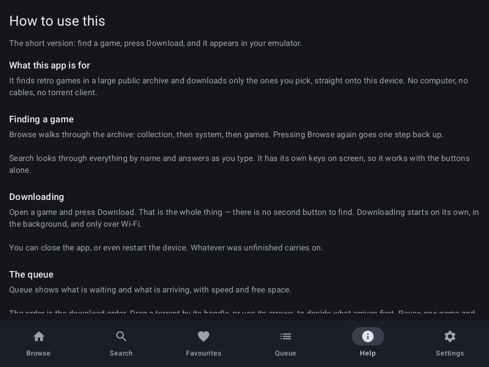

# Minerva Helper

An Android app that finds retro games in the public **MiNERVA** archive and downloads
**only the ones you pick** — straight onto a handheld console, with no computer involved.

Built for the **Anbernic RG477V** (GammaOS / Android 14), and usable with the gamepad
alone. It works on any Android 8.0 or newer device.

Repository: <https://github.com/PawelWywiol/minervahelper>

---

## The problem it solves

The MiNERVA archive holds **2.4 million files** in **1,049 torrents**. The torrents are
enormous and bundled together — a single one can list 300,000 files and weigh hundreds
of gigabytes.

To get one game the normal way you would have to work out which torrent contains it,
open it in a torrent client, find the game in a list of hundreds of thousands of
entries, untick everything else, and then move the file into the right emulator folder
by hand. Tedious on a computer. On a handheld with a small screen and no mouse,
practically impossible.

Minerva Helper does all of that for you. You search for a game and press Download. The
app works out the rest and fetches **only that one file** — 40 kilobytes instead of
several hundred gigabytes.

---

## What it looks like

| Browse the archive | Search |
|---|---|
|  |  |

| Game details | Download queue |
|---|---|
|  |  |

| Settings | Built-in help |
|---|---|
|  |  |

*Screenshots taken on the RG477V.*

---

## How it works

1. **It builds its own catalogue.** On first run the app downloads the archive's index
   (about 1.7 GB) and converts it into a compact 521 MB catalogue on the device. This
   takes roughly 11 minutes plus 80 seconds, once. Afterwards searching is instant and
   works offline.
2. **You pick a game.** Browse by collection and platform, or search by name.
3. **It downloads only that file.** The torrent protocol lets a client mark files as
   "skip". That is the whole trick behind this app.
4. **It checks the file.** Every download is verified against the archive's own
   checksum before it is accepted.
5. **It files it away.** The verified game is moved into the folder for its console,
   where your emulator front-end already looks for it.

## How to use it

**First run** walks you through three steps: a short disclaimer, choosing the folder
where games should land, and building the catalogue. Set it going and leave it — the
catalogue download continues in the background and survives closing the app or
rebooting the device.

**Then, day to day:**

- **Browse** or **Search** to find a game, and tap it to see its details.
- Press **Download**. That is all — there is no separate start button. Downloading
  begins by itself, in the background, over Wi-Fi only.
- **Queue** shows what is downloading and how fast. You can drag torrents into the
  order you want, pause a single game without stopping the others, and see how much
  free space is left.
- Finished games leave the queue, and lists mark what you already have.
- **Favourites** keeps games you want to remember.
- **Settings** is where you change the destination folders, the text size, and how many
  downloads run at once.

Everything is operable with the gamepad alone — including typing, which uses the app's
own on-screen keys because the Android keyboard ignores a D-pad.

**Help** carries this same guide inside the app, so nobody has to come back here to
remember how something works.

---

## This app never shares your files

Ordinary torrent clients upload to other people while and after they download. This one
does not, and cannot: as soon as a download finishes its torrent is stopped, and no
file content is ever sent out. This is a structural property of the app, not a setting
you can flip.

## What you download is your responsibility

The app hosts no files. It helps you fetch things from a public archive onto your own
device. Copyright rules differ between countries — what you choose to download, and
whether you are allowed to have it, is your decision. The author takes no
responsibility for it.

---

## Building it yourself

**You need:**

- **JDK 17** — newer versions do not work with the Android Gradle Plugin used here
- **Android SDK** (via Android Studio, or the standalone command-line tools)
- **adb**, to install onto a device
- A device running **Android 8.0 or newer**, with USB debugging enabled

**A note on JDK 17:** `gradle.properties` currently pins an absolute path to the
author's machine:

```properties
org.gradle.java.home=/opt/homebrew/opt/openjdk@17/libexec/openjdk.jdk/Contents/Home
```

If you are building anywhere else, change that line to your own JDK 17 path, or delete
it if `java -version` already reports 17.

**Build and install the debug version:**

```bash
git clone https://github.com/PawelWywiol/minervahelper.git
cd minervahelper
./gradlew :app:assembleDebug
adb install -r app/build/outputs/apk/debug/app-debug.apk
```

The app then appears in the launcher as **Minerva Helper**.

**Build a release version:**

```bash
./gradlew :app:assembleRelease
```

This produces `app/build/outputs/apk/release/app-release.apk`. Release builds are
signed with a key described by `keystore.properties`, which is deliberately not part of
this repository — you will need to create your own with `keytool`. Without it the build
still runs, but the APK is unsigned.

---

## Documentation

Fuller documentation lives in [`docs/`](docs/README.md) — what the app must do, how it
is put together, why particular decisions were made, and a log of what was built and
measured on real hardware.

## Licence

[MIT](LICENSE) — do what you like with the code, but it comes with no warranty and the
author carries no liability for it or for anything done with it.

## Status

Version 0.1.0. Everything works end to end and has been tested on the RG477V rather
than on an emulator. There are no automated tests — every claim in the documentation
comes from running the app on the actual device.
