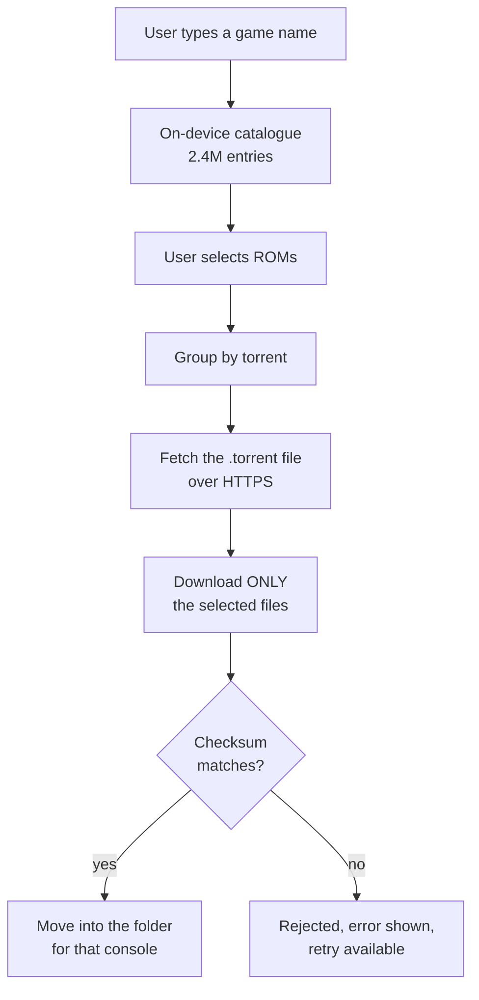

# How it is built

Written for non-programmers, avoiding jargon where possible. Terms are explained in
the [glossary](glossary.md).

## The flow: from a search to a finished file

Step **F** is the heart of it. A torrent may hold hundreds of thousands of files,
but the protocol lets us mark files as "skip". That is how we pull 40 kilobytes out
of a torrent weighing hundreds of gigabytes.

## How the app knows what is where

The archive publishes a database, `hashes.db` (1.64 GB), describing every file: its
name, size, checksums, which torrent it belongs to, and **its position within that
torrent**. That last detail is what makes selective downloading possible.

The database is too large and too slow to use directly, so on first run the app
converts it into a smaller catalogue of its own:

| | archive | our catalogue |
|---|---|---|
| size | 1,759 MB | **395 MB** |
| entries | 2.97M | 2.43M (junk filtered out) |

The savings come from dropping a redundant column, storing checksums compactly
instead of as text, and not repeating the same folder paths over and over.
Conversion takes **60 seconds** on the device.

## Main parts of the app

| Part | Responsible for |
|---|---|
| **Catalogue** (`data/catalog/`) | Fetching the archive database, converting it, searching |
| **Downloading** (planned) | Queue, torrent engine, pause and resume |
| **File placement** (planned) | Verification and moving into the user's folder |
| **Interface** (`ui/`) | Screens, gamepad handling |
| **Background work** (`work/`) | Running while the app is closed, notifications |

## Technologies and why

| Technology | Used for |
|---|---|
| Kotlin + Jetpack Compose | Language and UI toolkit — the Android standard |
| libtorrent4j | Torrent engine embedded in the app (no separate client needed) |
| SQLite + FTS4 | Catalogue storage and fast full-text search |
| WorkManager | Background work that survives app closure and reboots |
| OkHttp | HTTPS downloads |

We deliberately avoid dependency-injection frameworks and heavy abstraction layers —
this is a single-module project and is meant to stay simple.

## Two things worth knowing

**Downloading resumes; catalogue conversion does not.** Fetching 1.64 GB takes about
11 minutes and resumes from where it stopped. Conversion takes 60 seconds and starts
over if interrupted — repeating it is cheaper than guarding against a database
corrupted mid-write. [Rationale](decisions.md#d4).

**The app does not share downloaded files.** Once a download finishes, the torrent is
stopped. Importantly, this is done by stopping it and **not** by throttling upload
speed to zero — that would cripple downloading too. Diagnosing this cost us two
hours.
