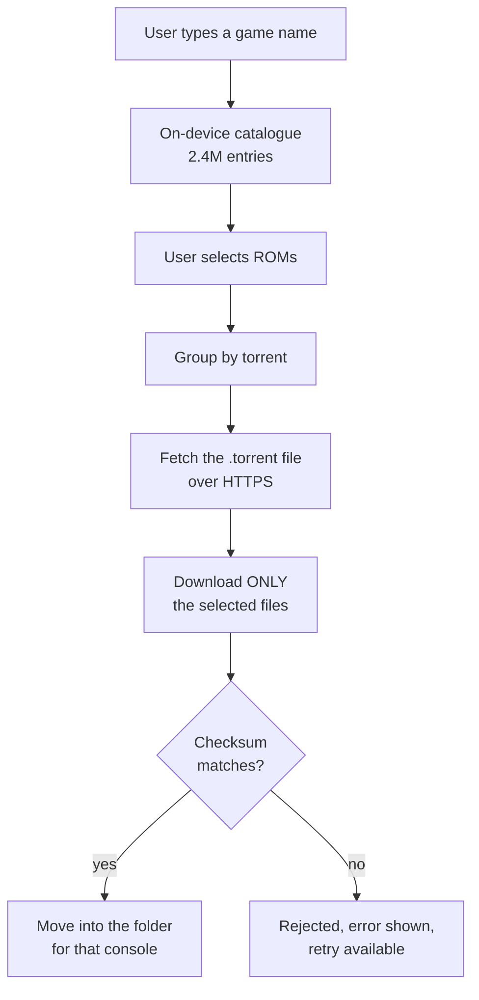

# How it is built

Written for non-programmers, avoiding jargon where possible. Terms are explained in
the [glossary](glossary.md).

## The flow: from a search to a finished file

Step **F** is the heart of it. A torrent may hold hundreds of thousands of files,
but the protocol lets us mark files as "skip". That is how we pull 40 kilobytes out
of a torrent weighing hundreds of gigabytes.

## How the app knows what is where

The archive publishes a database, `hashes.db` (1.64 GB), describing every file: its
name, size, checksums, which torrent it belongs to, and **its position within that
torrent**. That last detail is what makes selective downloading possible.

The database is too large and too slow to use directly, so on first run the app
converts it into a smaller catalogue of its own:

| | archive | our catalogue |
|---|---|---|
| size | 1,759 MB | **521 MB** |
| entries | 2.97M | 2.43M (junk filtered out) |

The savings come from dropping a redundant column, storing checksums compactly
instead of as text, and not repeating the same folder paths over and over.
Conversion takes **80 seconds** on the device.

## Main parts of the app

| Part | Responsible for |
|---|---|
| **Catalogue** (`data/catalog/`) | Fetching the archive database, converting it, searching |
| **Queue** (`data/queue/`) | What is waiting, in what order, what is paused, what is finished |
| **Downloading** (`data/download/`) | The torrent engine and pulling out only the chosen files |
| **File placement** (`data/placement/`) | Verification, platform → folder mapping, moving into the user's folder |
| **Settings** (`data/settings/`) | The user's choices — text size, how many downloads at once, first-run state |
| **Game info** (`data/metadata/`) | Canonical titles and cover art, fetched without an API key |
| **Interface** (`ui/`) | Screens, gamepad handling |
| **Background work** (`work/`) | Running while the app is closed, notifications |
| **Browser remote** (`data/web/`) | The optional server that lets a browser on the same Wi-Fi drive the app |

One torrent engine serves the whole app, not one per download — several downloads at
once share a single session, each with its own staging folder, because libtorrent is
built to manage many torrents in one session and running several sessions would
multiply memory and port use for no gain.

Titles and cover art come from libretro's public thumbnail server and from
hasheous.org, both looked up by checksum and neither needing an account. Anything
richer (descriptions, box scans from IGDB) is gated behind per-user API keys, which
is exactly the setup hassle this app exists to avoid.

## The browser remote

The app can hand its own controls to a browser on the same Wi-Fi. There is no second
server anywhere: the app *is* the server, and the page it serves ships inside the APK.

The browser never gets its own copy of a rule. Queueing a game from a browser calls the
very function the on-device Download button calls, so a file already sitting on the card
is recognised as downloaded there too; favourites, folders and the queue are the same
objects the screens use, which is why a change made in one place appears in the other
without either side refreshing.

How it is kept closed:

- **Off by default**, never auto-starts, stops itself when Wi-Fi goes away, and runs a
  notification the whole time — it cannot listen invisibly.
- Bound to the **Wi-Fi address only**, never `0.0.0.0` and never on mobile data.
- A browser is let in by a **six-digit code shown on the device**: single use, two-minute
  life, five wrong guesses lock pairing for five minutes. It then holds a 256-bit token
  in a `HttpOnly; SameSite=Strict` cookie, stored on the device only as a SHA-256 hash.
- Every request must name the address the server bound to, which is what stops a page
  elsewhere on the internet from pointing a hostname it controls at the handheld.
  Anything that changes state additionally needs a header no cross-site form can set.
- **No route returns the contents of a file on the device.** The only bytes it serves are
  the page itself, out of the APK, and a game's cover art, which is inlined into that
  game's own JSON rather than given an address of its own.

## Technologies and why

| Technology | Used for |
|---|---|
| Kotlin + Jetpack Compose | Language and UI toolkit — the Android standard |
| libtorrent4j | Torrent engine embedded in the app (no separate client needed) |
| SQLite + FTS4 | Catalogue storage and fast full-text search |
| WorkManager | Background work that survives app closure and reboots |
| OkHttp | HTTPS downloads |
| Ktor (CIO engine) | The browser remote's HTTP server, embedded in the app |
| Plain HTML + ES modules | The browser remote's page — no framework, no build step, no npm |

We deliberately avoid dependency-injection frameworks and heavy abstraction layers —
this is a single-module project and is meant to stay simple.

## Two things worth knowing

**Downloading resumes; catalogue conversion does not.** Fetching 1.64 GB takes about
11 minutes and resumes from where it stopped. Conversion takes 80 seconds and starts
over if interrupted — repeating it is cheaper than guarding against a database
corrupted mid-write.

**The app does not share downloaded files.** This is the project's hardest rule, and
it is enforced by construction rather than by a setting: the session accepts no
incoming connections, the unchoke limit is zero, and the torrent is removed on every
exit path — success, failure, pause and cancel alike. After each torrent the app
asserts that the bytes of file content uploaded were exactly zero and fails loudly if
not. Note that this is done by *stopping* the torrent, **not** by throttling upload
speed to zero: throttling cripples downloading too, because the protocol needs
request traffic to flow. Any change to the torrent engine must be re-checked against
this rule.

**There are no automated tests.** Every "done" here means somebody ran the app on the
real handheld and watched it work. This was a deliberate trade for a one-person
project whose riskiest parts — a torrent swarm, a 2.4-million-row database, a specific
handheld's gamepad — are exactly the parts a test on a build machine cannot honestly
reproduce. The cost is real: nothing catches a regression except the next person to
pick the device up. If this project ever grows a second developer, that trade should
be revisited.

## One name to know

The bottom menu's **Settings** tab opens `ui/settings/FoldersScreen.kt`. The file
began life as the folder mapping screen and kept the name while it grew text size and
parallel-download settings, so what the user calls "Settings" is what the code calls
"Folders".
